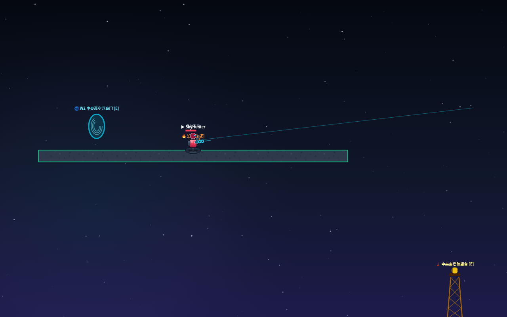

# SkyBlast 2D — 环形大世界 2D 横版 PVP



> **合并版**：把 **SkyBlast 2D**（`peerjs_battle_arena` v2 环形大世界玩法）灌入本仓库原有的
> **Teeworlds 风格三层骨架**（core / input / net / ui 分离 + 服务器权威 + 确定性模拟）。
>
> 一句话：**骨架给架构，SkyBlast 给内容**。两边恰好互补：
> 骨架有 transport 抽象 / 确定性 step / 单测，但没有玩法；SkyBlast 有 7 主武器 + 8 副武器 + 环形地图 + 占点 + 弹药经济，
> 但联机是各端自算（平行宇宙）。合并后所有玩法都在**服务器权威**下结算，并通过**统一快照**下发给各端。

---

## 运行

```bash
node src/main.ts              # Loopback 本地对局演示（服务器权威 + 快照插值 + killfeed）
node --test tests/*.test.ts   # 23 项：确定性/环形数学/武器/副武器/占点/补给/PeerJS 传输
npx tsc --noEmit              # 类型检查

npm run build:web             # 打包浏览器可玩页 → docs/bundle.js
npm run build:site            # 重新生成对局回放页 → docs/replay.html

python3 -m http.server 8123 --directory docs   # 本地起页：/index.html 可玩，/replay.html 回放
```

## 操作（桌面 / 触屏）

| 操作 | 桌面 | 触屏 |
|---|---|---|
| 移动 | A / D（无惯性，按下即极速） | 左半屏拖动 |
| 起飞（喷射/漂浮） | W / 空格 / ↑（耗能量，1s 预热） | 「喷」按钮按住 |
| 瞄准 | 鼠标（360° 自由瞄准） | 右半屏拖动 |
| 开火 | 鼠标左键 | 右半屏按住 |
| 装填 | R | 「装」按钮 |
| 换主武器 | 1-4 | —（原型未做按钮组） |
| 切副武器 / 使用 | T / G | — |

## 架构（三层单向依赖，core 零 IO）

```
core/    纯游戏逻辑（零 IO，可在服务端复用）
  wrap.ts      环形世界数学（水平+垂直双轴无缝循环，13200×4400）
  rng.ts       确定性随机（mulberry32；所有随机量走注入的 Rng）
  weapons.ts   7 主武器 + 8 副武器 + 全局玩法参数
  terrain.ts   660×220 碰撞网格：多层楼房/管道/地道/掩体/浮岛 + 21 个可破坏障碍物
  types.ts     领域类型（玩家/弹丸/手雷/地雷/空袭/障碍物/占点/弹药包/补给箱/迫击炮）
  snap.ts      快照 schema（含全部动态实体 → 联机一致性的根）
  sim/world.ts 服务器权威世界：物理/碰撞/武器/副武器/占点/弹药经济/击杀重生（确定性 step）
  sim/physics.ts 调优物理参数（用户确认值：mass 1.3 / gravity 1250 / jetpack 3000·280·0.5s）
input/   操作层：TouchState → InputMapper → Intent[]（含 interact/secondary/switchWeapon）
net/     联机层：Transport 抽象（Loopback / PeerJS 实现）
  ServerSim.ts   权威模拟 + 意图合并（瞬时意图单发消费）+ 事件流广播
  ClientSession.ts 意图流 / 快照+事件接收（欢迎包下发 playerId）
  StateSync.ts   快照插值（环形感知 lerp；离散实体取最新帧）
  transport/Peer.ts  PeerJS DataConnection → Transport 适配（JSON 协议，可单测）
  RoomManager.ts 房间/匹配（内存）
ui/      界面逻辑层：快照 → HUD 视图模型 / Presenter（不调网络/输入内部）
main.ts  组合根：唯一接线点；web/main-web.ts 浏览器可玩入口（内嵌 ServerSim）
```

**单向数据流**：`输入 → Intent → ServerSim → core/World.step → 快照+事件 → StateSync → Presenter/HUD/渲染`。

## 当前玩法（全部服务器权威结算）

- **对战模式**：大厅可选 **自由混战** 或 **双队对抗（红队 vs 蓝队）**；**每次出生随机安全点**；
  目标选择/队友免伤按队伍判定；击杀计分。
- **环形世界**：13200×4400 **双轴无缝循环**；跨缝瞄准/弹道/插值连续；渲染对地形/阴影/装饰做 ±WORLD 周期复制，边界不缺块。
- **缩放居中**：+30% 视野武器（狙/M249）与瞭望塔 200% 视野下，画面始终以玩家为中心缩放（先平移后缩放）。
- **城市街区地图（自定义）**：一整块平地（双轴环形）；地面 10 块街区掩体（x 4840~9840）+ 中层 16 块建筑 + 2 条高空长桥；
  可破坏方形掩体箱 6 个；出生点/据点/炮位/塔/传送门/补给均在地面空地。JSON 定义在 `src/core/map.ts` 的 `defaultMapData()`。
- **8 主武器**（重生前选定、部署后锁定）：
  霰弹枪 / 突击步枪 / **电磁狙击**（4000px/s、无限射程、命中即死，爆头 2.5×）/
  **重型火箭筒**（520px/s 直线慢速、无限射程、命中爆炸）/
  **🔫 战术手枪**（主武器、**移速最快 +30%**、备弹 48）/
  + 补给专属：高斯枪 / M249 / 奇点引力枪（狙击/M249 **+30% 视野**；高斯枪与引力枪视野正常）。
- **高斯枪 = 即时光束**：点击立刻打出一道光束，按秒存在（0.14s），**反射 2 次**；沿路径穿透伤害（**180 伤害/秒，弹量 12/48 = 连续 2 秒**）；
  **自伤**：反射回来的光束会打到自己（枪口第一段不自伤）；被实心墙体/可破坏掩体阻挡（不再穿透掩体箱）；
  不是飞行弹丸（不再有"棍子"式弹道）。
- **副武器只剩 手榴弹**：**1 充能上限、自然回复（6s/枚）**；**伤害 520（半径内一发致死，最远衰减仍 ≥100）**；替身人偶保留为**特殊补给专属**（拾取获充能）。
- **武器差异**：不同武器有不同 **移动速度倍率 / 飞行续航倍率**（手枪最快最久，火箭筒/M249 最重）。

### 武器数值表（单一来源 `core/weapons.ts`，经 1v1 对射模拟平衡）

**常规主武器（6 把，死亡界面/大厅改选）**：

> 展示顺序：手枪 → 霰弹 → 冲锋枪 → 突击步枪 → 狙击 → 火箭筒 → M249 → 高斯枪 → 引力枪（`WEAPON_DISPLAY_ORDER`）

| 武器 | 弹速 px/s | 伤害 | 弹匣/备弹 | 射速 | 移速× | 飞行× | 特性 |
|---|---|---|---|---|---|---|---|
| 手枪 | 1000 | 24 | 12/60 | 0.17s | **1.5** | **2.0（双倍容量）** | 移速 1.5×、升空速度 1.25×、飞行容量 2.0× |
| 霰弹 | 1000 | **24×8（=手枪弹）** | **8/72** | **0.72s** | 1.08 | 1.05 | 后坐力 ×2（1560）；贴脸一轮齐射致死；200→700px 衰减到 45% |
| 冲锋枪 | 1000 | **24（=手枪）** | 30/150 | **0.05s（极高）** | **1.25** | **1.0** | 极高射速、大散布（0.24）平衡 |
| 突击步枪 | 1500 | **33** | 28/140 | 0.12s | **1.0** | **1.0** | 伤害 33；正常移速/飞行 |
| 狙 | 4000 | 100（爆头 2.5×） | 3/15 | 0.95s + 0.6s 蓄力 | **0.6** | **0.6** | **>800px 非爆头只造成 99（留 1 血）**；单击也会自动蓄满击发 |
| 火箭筒 | 520 | 115（爆炸） | 1/20 | **0（节奏=2s 换弹）** | **0.7** | **0.7** | 直线慢速、无限射程、碰到即炸 |

**补给特武**：高斯枪（**180 伤害/秒，弹量 12/48 → 连续 2s，换弹 4s，视野正常、无瞄准线**，光束反射 2 次）、M249（120/240、0.06s、伤害=突击步枪）、引力枪（**穿墙** + 牵引 + **引力场只弯弹不消弹**（改变其他枪子弹方向，360px 内越近弯折越强）+ 距离衰减 **200→700px 到 12%**；伤害=手枪 24；视野正常）。

### 平衡模拟（1v1 AI 对射）

`node scripts/duel-sim.ts --seeds=40`（核心：`src/balance/duelSim.ts`）：权威 World 内两名 AI（瞄准抖动 0.02rad、随机左右走位、
对慢速弹/火箭做提前量）在 180 / 380 / 700px 三种距离、6 把主武器全对阵、40 种子（4320 场）下对射，
统计总胜率 / 各距离胜率 / 平均 TTK：

```
【常规主武器 · 40 种子 4320 场】
武器       总胜率  平局  平均TTK  180px  380px  700px
突击步枪    65.6%  2.2%   0.54    50.8%  66.3%  79.8%
冲锋枪      48.8%  2.0%   0.65    60.4%  40.0%  46.0%
火箭筒      50.6%  2.4%   0.58    65.4%  48.5%  37.7%
狙          44.9% 12.7%   0.73     2.7%  56.0%  76.0%
手枪        36.8%  2.3%   0.86    30.2%  35.4%  44.8%
霰弹        52.6%  2.0%   0.37    77.7%  70.8%   9.4%

【含超级兵器 · 25 种子 6075 场】
M249        66.4%  3.3%   0.67    63.8%  69.3%  66.2%
高斯枪      88.0%  1.6%   0.25    76.0%  93.6%  94.4%
突击步枪    56.7%  3.1%   0.79    46.4%  57.6%  66.0%
冲锋枪      43.5%  4.3%   0.83    56.0%  40.9%  33.6%
火箭筒      36.9%  6.5%   0.68    50.4%  36.2%  24.0%
狙          37.8% 10.8%   0.73    11.6%  35.8%  66.0%
手枪        27.2%  5.6%   1.00    28.4%  21.3%  31.8%
霰弹        52.5%  6.0%   0.50    86.2%  64.9%   6.4%
引力枪       8.7% 23.3%   2.55     8.2%  17.6%   0.4%   ← 防御型：弯折弹道改变对手命中
```

回归测试（第 43 个）固定 20 种子复跑，断言：全员总胜率 ∈[30%,70%]、霰弹近距 ≥60%、火箭近距 ≥55%、
狙远距 ≥60%、步枪中距 ≥35%、平均 TTK <3s。

### 移动 / 飞行

- 水平：**零惯性**——按下即极速、松手即停；撞墙直接停住（**不要滑**）。
- **配装界面**：**只有死亡界面**可选主/副武器（阵亡后倒计时期间，同时显示击杀者）；游戏进行中底部 HUD 只读显示当前武器/副武器，不再提供换枪按钮。
- **玩家碰撞**：玩家之间有实体碰撞箱，互相阻挡；可**站到别人头上**、也可**顶着人走**（轻推对方）；重叠时自动分离。
- **弹射跳台**：地表 4 处可见的青色弹射板（底座+向上箭头+光晕），**站在上面才会弹起**；空中经过或坠井不会误触。
- 飞行：**上升加速**（喷气推力加大，约 0.12s 达升空极速——比原来更快响应，极速不变）；
  **下降加速**（按住 S/↓ 或左摇杆下推，重力×1.55——与原版数值一致）；
  飞行槽 **= 原来的两倍（0.5→1.0，满槽可连续喷 2s）**，**仅落地回充**（0.7/s）→ 断续点按不能无限飞。
  （调参台存档 key 升版 `pvp-physics-params-v2`，旧存档不再覆盖新默认值）
- 大楼碰撞：墙体与楼板搭接（消除 20px 夹缝）、窗口 90px/门洞 110px 可通行；
  引擎级**防卡死**：出生校验 + 躯干嵌入实体 12 tick 自动推出。

### 表现层

- **地形贴图**（程序化 CanvasPattern，**世界锚定**：花纹随方块/物体一起移动，不再相对滑动）+ **sprite**（玩家/武器/道具/装饰层）+ **粒子特效**（爆炸/碎屑/尾焰/枪口）。
- **世界锚定背景**：星空/环境光随地形同速移动（不会背景固定、方块移动的眩晕感）。
- **高斯枪光束**渲染为分段折线（按秒淡出），**火箭弹**有弹头/尾翼/尾焰 sprite。

## 复活记住上次武器

- `PlayerState.lastPrimaryIndex`：记录**上次使用的常规主武器**。复活时自动恢复它（不用每次重新选）。
- **补给特武（高斯枪/M249/引力枪）是临时的**：拾取只改当前手持，不会写进 `lastPrimaryIndex`；
  带着特武阵亡 → 重生回到上次常规主武器，不会出现"复活后还卡着超级武器 / 掉回默认枪"的问题。
- 替身人偶回溯同样只恢复常规主武器记录；死亡界面默认选中项也跟着 `lastPrimaryIndex`（拿着特武时不会莫名回落到第一把）。

## 友军伤害 / 自伤（可选项）

默认规则：**只有 手榴弹 / 高斯枪 / 引力枪 / 火箭筒 会伤害队友和自己**，其余枪械（霰弹/突击/狙/M249/手枪/冲锋枪）友伤与自伤默认关闭。

- 枪械：`WeaponDef.friendlyFire` / `WeaponDef.selfDamage`（布尔，逐武器）；手雷：`GameConfig.grenadeFriendlyFire` / `grenadeSelfDamage`。
- 两者都是**运行时可选**：数值后台（admin.html）里每个武器有 `friendlyFire` / `selfDamage` 勾选框，全局配置里有手雷两个勾选框；
  也可以在代码里临时改 `WEAPONS[4].friendlyFire = false` 立刻生效（护栏测试验证了这个开关行为）。
- 自伤语义：枪械/爆炸对自己按 25% 伤害结算；地雷/迫击炮等非枪械来源保持旧行为（不伤友军、可自伤）。

## 数值调整后台

> 后坐力（recoil）现在**各向同性**：沿瞄准反方向施加，水平/垂直/斜向使用同一系数 `RECOIL_SCALE`（`src/core/sim/physics.ts` 的 `recoilDelta()`），
> 不再出现"上下后坐明显大于左右"的情况（护栏测试会检查）。


打开 `docs/admin.html`（游戏顶栏也有 ⚙️ 数值后台 按钮）：
- **武器数值**：9 把武器逐字段可改（damage/爆头倍率/弹速/弹匣/备弹/换弹/射速/蓄力/散布/衰减区间/移速/飞行/视野/爆炸…）；
- **全局配置**：maxHp/复活时间/手雷/地雷/人偶/迫击炮/瞭望塔/随机出生等；
- **物理参数**：重力/移速/跳跃/喷气背包等；
- 只保存**与默认值不同**的字段 → localStorage `pvp-balance-overrides-v1`；「保存并打开游戏」后游戏启动时应用；
- 支持导出/导入 JSON、恢复默认（同时清理旧调参页存档）。

## 地图编辑器

打开 `docs/editor.html`（游戏顶栏也有 🛠️ 地图编辑器 按钮）：
- 笔刷：平台 / 掩体 / 方块；左键拖拽绘制（20px 格点）、右键擦除；滚轮缩放、中键/空格拖拽平移；支持笔刷 1~10 格。
- 保存到浏览器（`pvp-editor-map`）；「应用到游戏」写入 `pvp-custom-map` 并跳转游戏，游戏启动时会加载自定义地形。
- 支持导出/导入 JSON（`{ name, solids: [{x,y,w,h,kind}] }`），核心校验在 `src/core/map.ts`。
- 数据/逻辑与游戏共用：`World(seed, map)` 接受 `MapData`，地形 = 平地 + 自定义 solids。

## 开发约定（防回归）

数值/地图改动很容易"改了这个坏那个"，因此仓库内置了三层护栏，`npm run check`（= typecheck + 全部测试）必须绿：

1. **`src/core/invariants.ts`**：集中声明硬性约定
   - 武器：跨武器规则（M249 伤害=突击、引力枪=手枪、冲锋枪=手枪、手枪 12/60、火箭筒 1/20 且射击间隔 0、狙击 >800px=99、霰弹 8 丸无爆头、高斯枪单匣 2s 且视野 1.0、手枪 1.5×移速/2×飞行/1.25×升空、火箭筒 0.7 三项…），以及字段范围（倍率 0~5、falloff start<end、复苏/换弹>0 等）。
   - 布局：默认地图下所有地标（出生/据点/炮/塔/传送门/补给/弹药/地雷）必须在空地且在边界内；跳台必须贴地且上方无遮挡；据点 id 唯一。
2. **`tests/guards.test.ts`**：把上述约定跑成测试，并额外验证固定出生/随机出生不嵌实体、空地形小地图可正常战斗、地图 solids 边界与 kind 合法。
3. **`tests/helpers.ts`**：新测试请优先用 `emptyWorld(seed)` / `worldWith(seed, solids)`，不要把断言钉死在默认地图坐标上；地图调整时只有 `layoutViolations` 相关的护栏会提示你需要移动哪些地标。

改数值的流程：改 `weapons.ts` → 若改变的是"约定值"，同步 `invariants.ts` → `npm run check`。
改地图的流程：改 `defaultMapData()` → `npm run check`，`layout.solid` 会列出被建筑盖住的地标，逐个挪到空地即可。
打 bundle：`npm run build:web` 会**自动**把 `docs/index.html` 的 `bundle.js?v=` 换成新内容哈希，无需手动 bump（此前手动版本号导致过缓存旧包问题）。

## 代码结构（工程化）

```
src/core/       权威模拟：types / weapons / wrap / terrain / sim(world, physics) / noita
src/input/      Intent 流：InputMapper → IntentBus
src/net/        Transport（Loopback/PeerJS）+ ServerSim + StateSync
src/web/        浏览器表现层（分类目录）：
  main-web.ts     入口/组合根（52 行：装配 + 启动 + __dbg/__tune）
  app/            context(状态源) / hud / toast / events / params
  game/           loop(主循环) / bots(AI) / loadout(配装部署)
  input/          bindings(所有 DOM 绑定) / device(设备检测)
  render/         scene(场景渲染)
  sprites.ts / textures.ts / effects.ts / controls.ts / fullscreen.ts
tests/           node --test（确定性/权威逻辑/网络/地图安全）
```

## 与上游的关系与署名

- 玩法内容（武器数值/地图布局/实体配置）来自 **SkyBlast 2D v2**（`peerjs_battle_arena (1).zip`，作者 Hana-ame）。
- 架构骨架（三层分离/Transport/ServerSim/StateSync/单测）来自本仓库原 **teeworlds-style-pvp**。
- 仓库已重命名为 **skyblast-2d**。

## 测试覆盖（23 项，`node --test tests/*.test.ts`）

确定性重放 · 环形数学（x/y 跨缝）· 垂直环绕 · 重力 · 狙击爆头穿透 · 弹药经济 · 手榴弹 · 护盾 · 替身人偶回溯 ·
可破坏障碍物 · 地雷直击 · 占点 · 补给箱 · Loopback 双客户端对局 · PeerJS 传输假连接 · 三层分离静态检查。

## 部署

- `docs/` 是 GitHub Pages 部署目录（`docs/index.html` 可玩、`docs/replay.html` 回放、`docs/tuning.html` 物理调参）。
- 推送后 CI（`.github/workflows/ci.yml`）跑测试 + 类型检查 + 两个构建。

## 下一步（未完成，明确列出）

1. **浏览器联机入口（下一里程碑）**：`net/transport/Peer.ts` 已是可测的 PeerJS 适配层；差「主机跑 ServerSim + 客机以快照渲染」的页面接线（含大厅 PeerJS 配对面板）。
2. **联机大厅接线**：`server/server.js`（v2 带入的零依赖 HTTP 房间/等待/聊天服务端）可接回大厅面板。
3. **主机迁移**：`RoomManager` 有设计位，未实现。

> UI 状态（2026-11-06 晚）：v2 的完整界面已移植回新架构——大厅（队伍/重生点/主副武器/AI 数量按钮组）、
> 重生前配装锁定、双摇杆触屏、HUD（血条/护盾/能量/比分/弹药/换弹进度/副武器 CD）、killfeed、交互横幅、
> 数值后台、Toast；高斯枪/M249/引力枪与替身人偶按规则走补给箱。